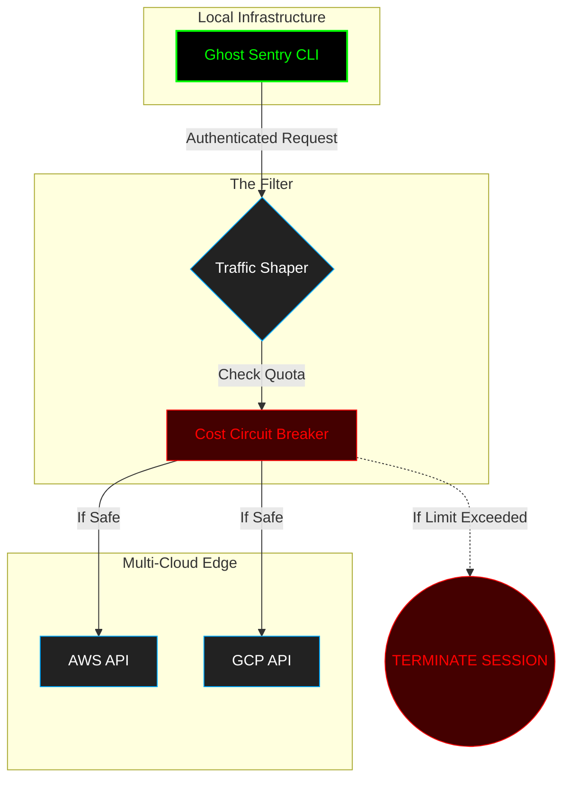

# 🛡️ Ghost Sentry: The AI Token Circuit Breaker

> **STATUS: [UNDER CONSTRUCTION]** - *Architecting the barrier between your innovation and a $10,000 cloud bill mistake.*

Every autonomous agent is a potential financial leak. In the "Go-Horse" era of AI development, agents can enter infinite reasoning loops, burning through tokens and budget in minutes. **Ghost Sentry** is a lightweight, hardened proxy designed to monitor, limit, and kill "runaway" AI processes before they explode your billing.

---

## 📉 The Problem: The "Token Burn" Loop
When an AI agent is misconfigured or hits an edge case, it may start a recursive loop of API calls. Without a circuit breaker, you only find out when the invoice arrives.

## 🛡️ The Solution: Agentic Hardening
Ghost Sentry acts as a sovereign middleware between your application and the AI providers (OpenAI, Anthropic, AWS Bedrock).

### Key Features (In Development):
- **Real-time Burn Rate Monitor:** Tracks spending per second/minute.
- **Budget Circuit Breaker:** Hard-kills any process that exceeds a pre-defined "blast radius" (e.g., $5.00 per task).
- **Sovereignty Audit:** Logs intent and token usage without leaking proprietary data to the cloud provider.

---

## 🏗️ Architecture Blueprint (Mermaid)

🚀 Why Ghost Sentry?
In the DevSecOps Standards, security isn't just about preventing hacks—it's about financial and operational stability. Ghost Sentry is part of the Hardened by Design philosophy: build it safe, or don't build it at all.

Crafted by: [Thiago Nazario/Ghost Architect]
